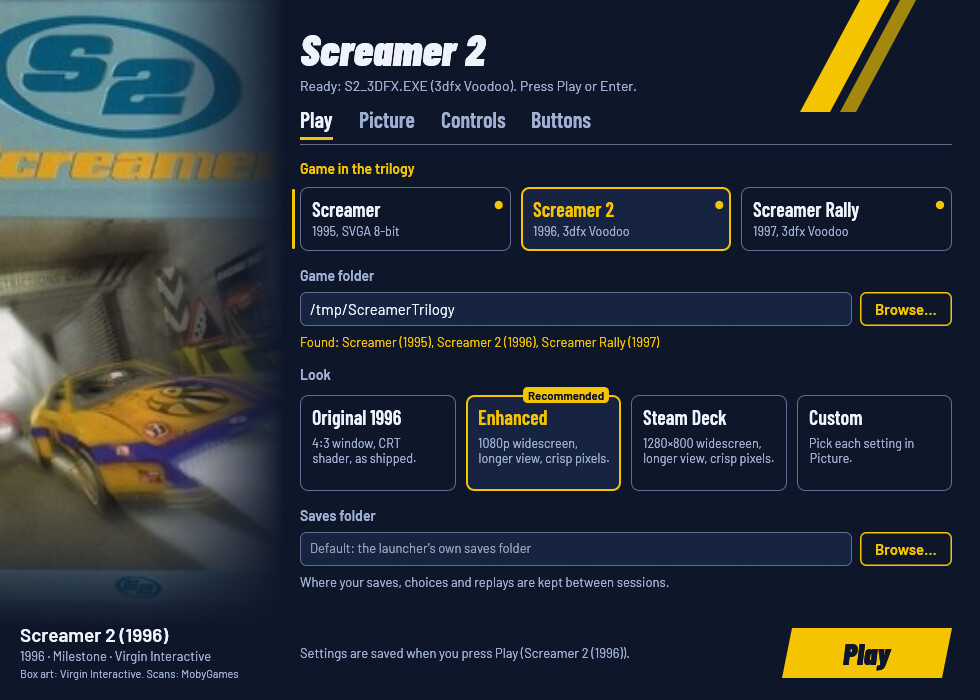
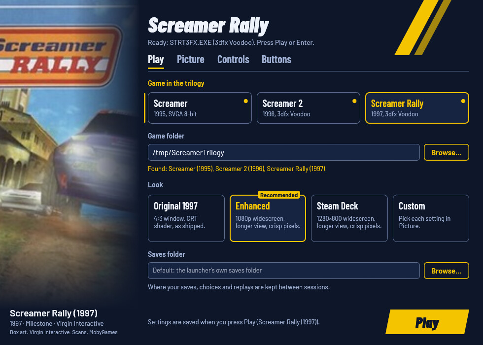
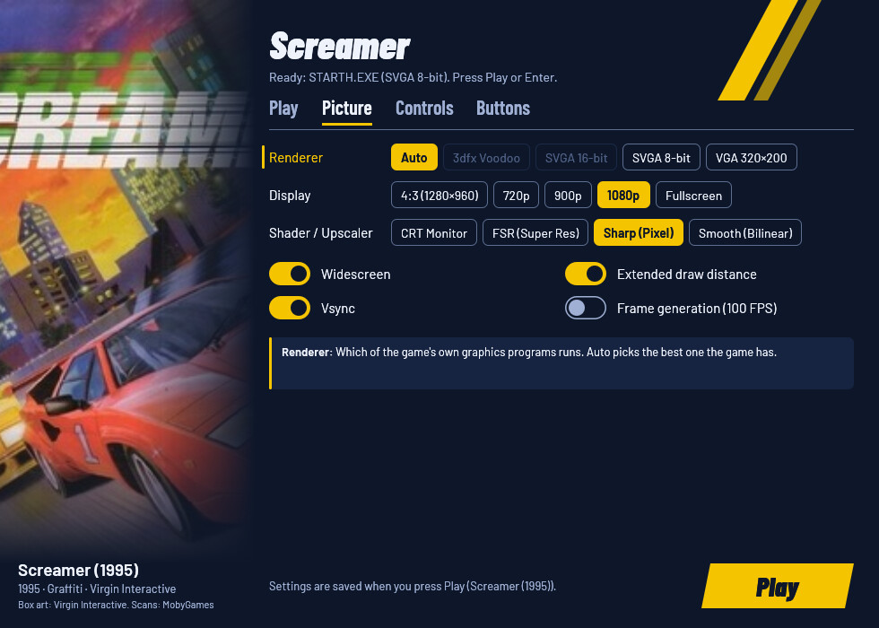
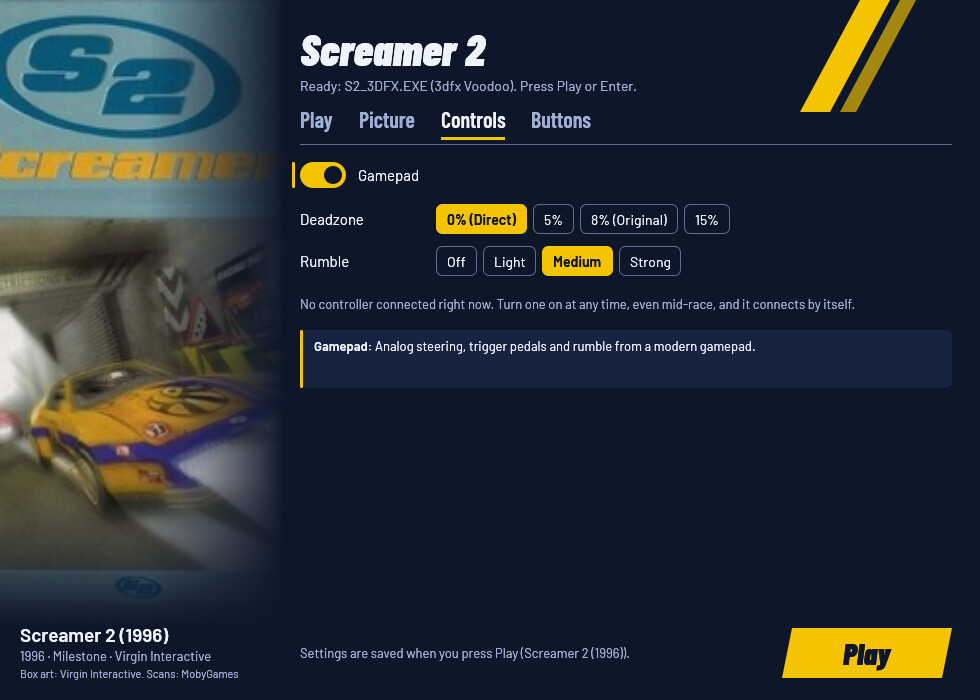
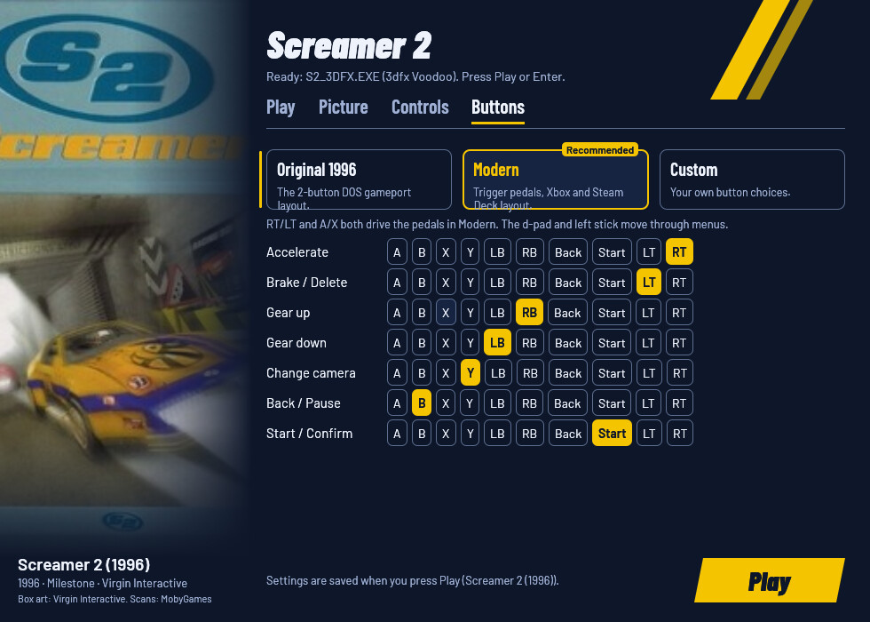

# Screamer Trilogy Launcher

Play your own copy of **Screamer** (1995), **Screamer 2** (1996) and
**Screamer Rally** (1997) on Windows 10/11, the Steam Deck and Linux, with
native Windows and Linux builds. Point the launcher at one game's folder
or at a folder holding all three, and press **Play**. DOSBox, the game's
setup and the controller support come with it: no `SETUP.EXE`, no DOSBox
configuration, no mapper files. Your game folder is only read, never
changed; the launcher plays from a private copy.

This project contains no game files: you need your own copy of the games.

> Played end to end on a Linux desktop (all three games). Native Windows
> 10/11 and the Steam Deck have not been tested with the real games yet;
> reports are welcome in the [issues](https://github.com/akitaonrails/rea-screamer-trilogy/issues).

[](https://new-uploads-akitaonrails.s3.us-east-2.amazonaws.com/2026/11/02/rea-screamer-trilogy/showcase-h264.mp4)

*Screamer (1995) running through the launcher with the Enhanced look on Linux. Click to watch (2:02, with sound).*

## Problems this launcher solves

| Problem | What the launcher does |
| --- | --- |
| The games are MS-DOS programs and need DOSBox, a sound card setup and a joystick setup before they start. | Ships its own DOSBox ([dosbox-staging](https://github.com/dosbox-staging/dosbox-staging)) and writes the games' sound, path and controller settings for you before each start. |
| GOG's copies come as CD images with cue sheets, and the music is on the CD's audio tracks. | Finds the CD image in your folder and mounts it with its music. |
| Screamer 2's 3dfx version doesn't run from GOG's copy, and the 3dfx versions quit with `MAXCACHE` or a Glide error partway through. | Uses Screamer Rally's DOS 3dfx driver for Screamer 2 when both games are in the folder, and fixes the texture-cache bug that made them quit. |
| A few spots in the games crash or hang under DOSBox (the graphics mode, the memory check). | Fixes them in the private copy of each game it recognises. |
| The picture is 4:3 and gets stretched on a widescreen. | 16:9 widescreen that shows more to the sides instead of stretching (seen in Screamer; see Known limitations). |
| Scenery pops in close to the car. | Extended draw distance: scenery and cars appear farther ahead. |
| A modern gamepad isn't seen, or steers like a digital joystick. | Analog steering, trigger pedals, rumble and your own button layout, with the pad and the keyboard working together in menus and races. |
| Patching the game folder by hand risks your only copy. | Your folder is only read. The launcher works on a private copy and refuses any build it doesn't know, with a link to report it. |

## Screenshots

| Play (Screamer 2) | Play (Screamer Rally) |
| :---: | :---: |
|  |  |

| Picture | Controls | Buttons |
| :---: | :---: | :---: |
|  |  |  |

## What you need

- Your copy of **Screamer**, **Screamer 2** or **Screamer Rally**, or all
  three: the GOG releases or the original CDs. One game's folder works,
  and so does a folder holding the three games' folders.
- Nothing else: the launcher brings its own DOSBox.

The launcher recognises each game's programs (`STARTH.EXE`,
`S2_3DFX.EXE`, `STRT3FX.EXE` and the others) by their SHA-256. A program
with a game's name that it doesn't know is not used: the window and
`--check` show its SHA-256 and a link to the
[unknown edition form](https://github.com/akitaonrails/rea-screamer-trilogy/issues/new?template=unknown-edition.yml).
Report the code, never the file.

## Download and install

Download from the [latest release](https://github.com/akitaonrails/rea-screamer-trilogy/releases/latest):

- Windows: `ScreamerLauncher-v<version>-windows-x86_64.zip`
- Linux: `ScreamerLauncher-v<version>-x86_64.AppImage` or `ScreamerLauncher-v<version>-linux-x86_64.zip`

### Windows

1. Unzip it anywhere outside your game folder, for example
   `C:\Games\ScreamerLauncher`.
2. Keep `ScreamerLauncher.exe`, `dosbox.exe`, the DLLs and the `resources`
   folder together.
3. Run `ScreamerLauncher.exe`. It is unsigned, so the first start from a
   downloaded zip may show "Windows protected your PC": click **More
   info**, then **Run anyway**.

### Steam Deck

1. In Desktop Mode, keep the AppImage somewhere (for example
   `~/Games/ScreamerLauncher.AppImage`) and make it executable
   (Properties → Permissions, or `chmod +x`).
2. Steam → **Games → Add a Non-Steam Game to My Library… → Browse**, and
   pick the AppImage. No Proton: it is a native Linux program.
3. Back in Game Mode, start it from your library. The **Steam Deck** look
   is recommended on the Deck's screen, and the pad drives the window.
   Game Mode has not been tested with the real games yet.

### Linux: AppImage

```sh
chmod +x ScreamerLauncher-v<version>-x86_64.AppImage
./ScreamerLauncher-v<version>-x86_64.AppImage
```

It contains the launcher, its DOSBox and the libraries they need. If
[gamescope](https://github.com/ValveSoftware/gamescope) is installed, the
game runs in it at the size you chose, scaled to the screen; otherwise in a
plain DOSBox window.

### Linux: zip

Unpack it, for example into `~/Games/screamer-launcher`, and run
`linux/screamer-play` (the window, then the game; it uses gamescope when
installed). `screamer-play --play` plays with the saved settings,
`screamer-play stop` ends the game, and `screamer-play status` says
whether it runs. [`linux/README.md`](linux/README.md) has the details,
Steam and the environment variables.

## First run

1. Under **Game folder**, press **Browse…** and pick the folder with your
   game, or the folder holding all three.
2. Pick the game under **Game in the trilogy**. Games not in the folder say so.
3. Pick a look: **Enhanced** is recommended, **Steam Deck** on a Deck.
4. Press **Play** (or Enter, or Start on a pad).

The first start copies the game into the launcher's private folder (about
the size of the game's folder; code files are linked instead of copied
when they are on the same drive, and CD images stay in your folder).
Later starts copy only what changed.

## The settings window

- **Play**: the game, your game folder, the look and where your saves are
  kept.
- **Picture**: which of the game's graphics programs runs (Auto picks the
  best one the game has), the window size, the shader, and switches for
  widescreen, draw distance, vsync and frame generation. A board under the
  settings explains the one you point at.
- **Controls**: the gamepad, its deadzone and rumble.
- **Buttons**: the button layout (Original, Modern or your own) and the
  button for each action.

| Look | Window | Widescreen | Draw distance | Shader | When to pick it |
| --- | --- | --- | --- | --- | --- |
| **Original** (1995, 1996 or 1997) | 4:3, 1280×960 | off | as shipped | CRT Monitor | The game as it shipped. |
| **Enhanced** | 1920×1080 | on | extended | Sharp (Pixel) | Recommended on a desktop or laptop. |
| **Steam Deck** | 1280×800 | on | extended | Sharp (Pixel) | Recommended on the Deck; picked automatically there. |
| **Custom** | your choice | | | | Any change in the Picture tab. |

The first run saves the recommended look for your screen. Every look runs
the game at its own 50 frames per second.

The window works with the keyboard alone (Tab moves, arrows change a row,
Space switches, Ctrl+Tab changes tab, Enter plays) and with a pad (d-pad
moves and changes, A switches, LB/RB change tab, Start plays). A greyed-out
choice says why on the window, under its row (and when you point at it),
for example a renderer the chosen game doesn't have.

## Gamepad

The launcher reads the pad itself and gives the game analog steering,
trigger pedals and rumble, in all three games. Turn the pad on at any
time, even mid-race, and it connects by itself. The keyboard keeps working
alongside it. Tested with an 8BitDo Ultimate 2.

The **Modern** layout (the default):

| On the pad | In menus and name entry | In a race |
| :--- | :--- | :--- |
| D-pad / left stick | Move | Steer |
| RT / right stick up | | Accelerate (analog) |
| LT / right stick down | | Brake (analog) |
| A | Confirm, type a letter | Full throttle |
| B | Back | Pause |
| X | Delete a letter | Full brake / reverse |
| Y | | Change camera |
| RB / LB | | Gear up / down |
| Start | Skip the intro, confirm your name | Confirm in the pause menu |
| Back / Select | Back | Pause |

**Original** is the two-button DOS gameport layout, and **Custom** lets
you pick the button for each action in the Buttons tab.

## Options

Every option has the same name in the window, in `launcher.cfg`
(underscores) and as a command-line flag (hyphens). `launcher.cfg` is
listed under **Where things live**; the first run writes it with every
option, commented out.

| `launcher.cfg` / flag | In the window | Values | Unset | What it changes |
| --- | --- | --- | --- | --- |
| `which` / `--which` (or a bare `1`, `2`, `rally`) | Play: Game in the trilogy | `screamer`, `screamer2`, `screamer-rally` | `screamer` | Which game Play starts. |
| `game` / `--game` | Play: Game folder | a folder | `SCREAMER_GAME_DIR`, else none | The folder with your game, or with two or three of them. Only read. |
| `saves` / `--saves` | Play: Saves folder | a folder | the launcher's saves folder | Where your saves, choices and replays are kept between sessions. |
| `runtime` / `--runtime` | (file and flag only) | a folder | the launcher's runtime folder | Where the launcher keeps its private copy of the game. |
| `dosbox` / `--dosbox` | (file and flag only) | a dosbox-staging program | the bundled one | Runs the game with another DOSBox. |
| `look` / `--look` | Play: Look | `original`, `enhanced`, `steam_deck` | none (the first run saves the recommended one) | Sets every picture option below at once, as the look cards do. Picture options set after it win; `--look` replaces the saved picture for one run. |
| `renderer` / `--renderer` | Picture: Renderer | `auto`, `3dfx`, `svga16`, `svga8`, `vga` | `auto` | Which of the game's graphics programs runs; Auto picks the best one the game has. |
| `resolution` / `--resolution` | Picture: Display | `WIDTHxHEIGHT`, `fullscreen`, `original` (4:3, 1280×960) | 1920×1080 | The window size. |
| `texture_filter` / `--texture-filter` | Picture: Shader / Upscaler | `original` (CRT), `fsr`, `sharp`, `smooth` | `sharp` | How the picture is enlarged: CRT look, FSR, crisp pixels or smooth. |
| `widescreen` / `--widescreen` | Picture: Widescreen | `on`, `off` | `on` | On a 16:9 screen, shows more to the sides instead of stretching. |
| `extended_draw_distance` / `--extended-draw-distance` | Picture: Extended draw distance | `on`, `off` | `on` | Scenery and cars appear farther ahead, so less pops in. |
| `vsync` / `--vsync` | Picture: Vsync | `on`, `off` | `on` | Waits for the screen's refresh, so the picture never tears. |
| `frame_generation` / `--frame-generation` | Picture: Frame generation (100 FPS) | `on`, `off` (the old `fps_limit` still works: 60 or more is on) | `off` | Shows 100 frames per second by blending a frame between each of the game's 50; the game runs as always. Experimental. |
| `scaler` / `--scaler` | Picture: Scaler (Linux only) | `nearest`, `pixel`, `fsr`, `linear` | `fsr` | How gamescope enlarges the game to the screen (read by `screamer-play`). |
| `gamepad_axes` / `--gamepad-axes` | Controls: Gamepad | `on`, `off` | `on` | Analog steering, trigger pedals and rumble from a modern pad. |
| `deadzone` / `--deadzone` | Controls: Deadzone | `0` to `30` (percent) | `0` | How far the stick moves before the car steers (the game had 8). |
| `rumble` / `--rumble` | Controls: Rumble | `0` to `100` | `60` | How strongly the pad rumbles when you brake hard. |
| `buttons` / `--buttons` | Buttons | `modern`, `original`, or 8 button numbers | `modern` | The pad's buttons for accelerate, back, camera, gear down, brake, gear up, select and start. |

An unset key uses the launcher's default in the **Unset** column; the
launcher writes the games' own setup files at every start, so there is no
game value to keep.

On the command line, options override `launcher.cfg` for one run, and
only `--game` and `--which` are saved. The launcher's own switches:

- `--no-window`: play with the saved settings, without the window.
- `--settings [--linux]`: only the window. Exit code 0: Play pressed;
  3: closed without Play; 4: no window possible (play with the saved
  settings).
- `--check`: checks every game in the folder and every fix, without
  playing, and writes the report to `launcher.log` too. While the
  launcher's window is open, or a game runs, it is refused with exit
  code 5.
- `--controllers`: lists the connected pads.
- `--help`: every option and switch.

Closing the window without pressing Play exits 0. Exit codes for
scripts: 0 played or checked, 2 an error (see
`launcher.log`), 5 the launcher or its game is already running (nothing
started), otherwise the game's own.

## Where things live

| What | Windows | Linux |
| --- | --- | --- |
| Settings (`launcher.cfg`) and log (`launcher.log`) | `%APPDATA%\ScreamerLauncher\` | `~/.config/screamer-launcher/` |
| The launcher's copy of each game (runtime) | `%LOCALAPPDATA%\ScreamerLauncher\runtime\<game>\` | `~/.local/share/screamer-launcher/runtime/<game>/` |
| Your saves (`CHOICE.DAT`, `*.SAV`, replays) | `%APPDATA%\ScreamerLauncher\saves\<game>\` | `~/.local/share/screamer-launcher/saves/<game>/` |
| `screamer-play`'s logs and lock | | `~/.config/screamer-launcher/` |

The launcher writes nothing to the Windows registry.

A `launcher.cfg` next to `ScreamerLauncher` is used instead (a portable
setup), and the log goes next to it. `runtime =` and `saves =` in
`launcher.cfg` choose other folders (never inside the game folder).

The games write their saves into the runtime copy. The launcher copies
them to the saves folder when a game ends and back before the next start,
so the saves folder holds your progress, and the runtime copy has a copy
of it too.

## Troubleshooting

- **"… is a build this launcher does not know, SHA-256 … It is not used."**
  Your copy has a program the launcher hasn't seen. Report the SHA-256
  with the [unknown edition form](https://github.com/akitaonrails/rea-screamer-trilogy/issues/new?template=unknown-edition.yml);
  never attach the file.
- **"No Screamer, Screamer 2 or Screamer Rally in this folder."** Pick
  the folder that holds the game's programs (`STARTH.EXE`, `S2_3DFX.EXE`,
  `STRT3FX.EXE`), or the folder above the three games' folders.
- **The game says "PLEASE INSERT … DISK".** The launcher found no usable
  CD image. It looks for one next to the game's programs, in the game
  folder, and in every folder directly inside either of them: a `.cue`
  sheet with its `.bin`, an `.iso`, GOG's `.dat` and `.gog`, or a bare
  `.bin`/`.img` (a CloneCD rip; it plays without the CD music). A cue
  sheet whose image was renamed or left out is skipped. `--check` and
  `launcher.log` say which folder was searched and which file a cue sheet
  is missing.
- **3dfx Voodoo is greyed out for Screamer 2.** GOG's Screamer 2 lacks
  the DOS 3dfx driver. Put Screamer Rally's folder next to it (in the same
  parent folder) and the launcher uses Rally's driver.
- **The pad isn't seen.** Run `ScreamerLauncher --controllers` (or
  `screamer-play --controllers`) to list the pads the launcher finds;
  wake a wireless pad before starting.
- **The window doesn't open (Linux, no display or OpenGL).** The launcher
  plays with the saved settings instead; `launcher.log` says why.
- **Anything else:** run `ScreamerLauncher --check`, then open a
  [bug report](https://github.com/akitaonrails/rea-screamer-trilogy/issues/new?template=bug-report.yml)
  with `launcher.log` (remove personal paths). Never attach game files.

## Known limitations

- The games run at 50 frames per second. Every attempt to raise it broke
  their physics, so it stays. Frame generation shows 100 frames per second
  on top of that (measured in a Screamer race).
- At the Enhanced and Steam Deck sizes, Screamer 2 and Screamer Rally
  draw their 3D at twice the original resolution in software and can
  show fewer frames: about 40 in Screamer 2 and 30 in Rally in a
  headless test on a machine that was also running other tests. The
  race itself keeps its speed. The
  Original look, or Frame generation, gives a smoother picture there.
- Widescreen in Screamer 2 and Screamer Rally was checked in screenshots
  only: the 3D view is wider without stretching, but the dashboard
  (speedometer, lap panel) is stretched to 16:9.
- Screamer (1995) has no 3dfx build of its own. The community "3DFX
  Voodoo 3 Patch" replaces `STARTH.EXE`/`STARTL.EXE` with executables
  that its author says need a real Voodoo 3 (not a Voodoo 1, the card
  DOSBox emulates), so the launcher refuses a folder patched that way:
  keep the game's original programs to play it here.
- The games' control setup (`CONFIG/CONTROLS.CFG`) is written at every
  start. The games themselves never save it (only their setup program
  does, which the launcher never runs), so nothing is lost.
- Not yet tested with the real games: native Windows 10/11, the Steam
  Deck, 1440p and 4K screens, ultrawide screens. What was checked is in
  [`docs/RUNTIME_NOTES.md`](docs/RUNTIME_NOTES.md).

## Uninstall

1. **Back up your saves:** `%APPDATA%\ScreamerLauncher\saves\` on Windows,
   `~/.local/share/screamer-launcher/saves/` on Linux (or the folder you
   set as `saves`). The steps below delete them.
2. Delete the launcher's folder, or the AppImage.
3. Windows: delete `%APPDATA%\ScreamerLauncher` (settings, log, saves) and
   `%LOCALAPPDATA%\ScreamerLauncher` (the private copies of the games,
   about the size of your game folders). There are no registry entries
   to remove.
4. Linux: delete `~/.config/screamer-launcher` and
   `~/.local/share/screamer-launcher`, after copying the saves out. If
   you added it to Steam, remove the shortcut.

Your game folder was never changed, so there is nothing to undo there.

## For developers

Rust (edition 2024) for the launcher and the hooks, MinGW-w64 (x86_64)
with lld for the Windows build (GNU ld 2.47 links an executable that
crashes before `main`), Wine for the Windows-target tests, `cargo-deny`;
the `gaming` distrobox has them all. Building the bundled DOSBox also
needs `meson`, `ninja-build`, `pkg-config`, `libsdl2-dev`,
`libopusfile-dev`, `libspeexdsp-dev`, `libasound2-dev`, `libpng-dev`,
`zlib1g-dev` and `libgl1-mesa-dev`, plus `libwayland-dev` and
`libxkbcommon-dev` for the settings window.

```sh
git submodule update --init --depth 1 vendor/dosbox-staging
./scripts/build-dosbox.sh                          # target/release/dosbox with the hooks linked in
cargo build --release --workspace                  # target/release/ScreamerLauncher
```

`dosbox-staging` is a submodule at `vendor/dosbox-staging`, patched with
`patches/dosbox-staging-screamer-hooks.patch`; the `screamer-hooks` crate
builds `libscreamer_hooks.a`, which is linked into it.

The checks (the same list as `AGENTS.md`):

```sh
cargo fmt --all --check
cargo test --workspace --locked                    # host tests, the window headless
cargo clippy --workspace --all-targets --locked -- -D warnings
cargo clippy --target x86_64-pc-windows-gnu --workspace --all-targets --locked -- -D warnings
cargo deny check
for t in linux/tests/*.sh; do sh "$t"; done
cargo build --release --locked --target x86_64-pc-windows-gnu
sh sdk/packaging/check-imports.sh target/x86_64-pc-windows-gnu/release/*.exe
sdk/scripts/wine-test --locked --workspace --target x86_64-pc-windows-gnu   # Windows-target tests under Wine, headless
sh <sdk>/scripts/sdk-sync --check .                # sdk/ matches the pinned SDK tag
```

- Moving to a new SDK: `sdk/scripts/sdk-bump vX.Y.Z` (Cargo tags, `sdk/`,
  workflow pins; prints the Migration notes), then
  `sdk/docs/playbooks/sdk-change.md`. A weekly workflow opens that pull
  request by itself.
- Freeing disk space: `sdk/scripts/clean` (dry run), then
  `sdk/scripts/clean --yes`.
- Golden snapshots of `--help`, the template and what each look writes
  are in `crates/screamer-launcher/tests/snapshots/`. Review every diff;
  `UPDATE_SNAPSHOTS=1 cargo test --test snapshots` accepts one.
- The real-game test: `SCREAMER_GAME_DIR=<folder> cargo test -- --ignored`
  (read only).
- CI (GitHub Actions, the SDK's reusable workflows) tests every push,
  builds the Linux zip and AppImage and the Windows zip, and a `v*` tag
  publishes them with build-provenance attestations and the recursive
  corresponding-source archive.
- More: [`AGENTS.md`](AGENTS.md) (rules for contributors and agents),
  [`docs/05-launcher-in-depth.md`](docs/05-launcher-in-depth.md) (how each
  fix, the frame generation and the gamepad hooks work),
  [`docs/03-screamer-binary-analysis.md`](docs/03-screamer-binary-analysis.md),
  [`docs/04-screamer-engine-and-patches.md`](docs/04-screamer-engine-and-patches.md),
  [`docs/01-distrobox-gaming-findings.md`](docs/01-distrobox-gaming-findings.md),
  [`docs/02-cmr-launcher-architecture.md`](docs/02-cmr-launcher-architecture.md),
  [`docs/RESEARCH.md`](docs/RESEARCH.md),
  [`docs/RUNTIME_NOTES.md`](docs/RUNTIME_NOTES.md) and
  [`docs/CONTRIBUTIONS.md`](docs/CONTRIBUTIONS.md) (PCGamingWiki drafts,
  posted only by the owner).

## How it works

1. Finds each game in your folder and identifies its programs by SHA-256.
2. Copies the game into its private folder (code linked when it can, CD
   images left in place) and brings your saves in.
3. Applies the fixes for that exact build to the private copy, and writes
   the game's setup files and the DOSBox configuration.
4. Starts its DOSBox, with the gamepad hooks linked in, on the private
   copy, mounting the CD image.
5. When the game ends, copies your saves back to the saves folder.

## Built on rea-launcher-sdk

The runtime copy, save mirroring, `launcher.cfg` and the option table
behind `--help` and the window, the settings-window widgets,
`screamer-play`'s `rea-play.sh` library, packaging and CI come from
[rea-launcher-sdk](https://github.com/akitaonrails/rea-launcher-sdk),
pinned by tag in `Cargo.toml` and vendored in `sdk/` (the tag is in
`sdk/VERSION`). Screamer's own parts are the edition table, the LE parser
and the binary fixes, the DOSBox configuration and hooks, and the
window's tabs.

## Contributing

- **About the Screamer games** (their editions, fixes, settings, DOSBox
  and the hooks, `screamer-play`'s game settings, this README): issues and
  pull requests here.
- **Shared code** (the runtime folder, settings-window widgets, the option
  table, `rea-play.sh`, packaging, CI workflows, anything under `sdk/`):
  issues and pull requests at
  [rea-launcher-sdk](https://github.com/akitaonrails/rea-launcher-sdk/issues).
- **How to tell:** code under `sdk/` or from a `rea_launcher*` crate is
  the SDK's. If the same problem would happen with another rea launcher,
  it's the SDK's. Not sure? Open it here and it will be moved.
- Never patch `sdk/` or copy SDK code here: fix the SDK and bump the tag.
- Never attach game files (executables, saves, data) to an issue.
- Test reports are welcome: the
  [bug report form](https://github.com/akitaonrails/rea-screamer-trilogy/issues/new?template=bug-report.yml).

## Credits

- [dosbox-staging](https://github.com/dosbox-staging/dosbox-staging): runs the games, with its 3dfx Voodoo emulation.
- GOG's releases, whose layouts the launcher reads, and Screamer Rally's DOS `GLIDE2X.OVL`, which lets Screamer 2's 3dfx version run.
- AMD's FidelityFX Super Resolution 1.0, the algorithm behind the FSR shader.
- The box art of the three games, © Virgin Interactive, from MobyGames scans (used by the owner's decision).
- The Barlow fonts by Jeremy Tribby (SIL OFL), through rea-launcher-sdk.
- [PCGamingWiki](https://www.pcgamingwiki.com/wiki/Screamer)'s pages on the games.
- [rea-launcher-sdk](https://github.com/akitaonrails/rea-launcher-sdk).

Full list with licences: [THIRD_PARTY.md](THIRD_PARTY.md).

## Legal

Screamer, Screamer 2 and Screamer Rally are © their rights holders
(developed by Graffiti / Milestone, published by Virgin Interactive). This
project is not affiliated with or endorsed by them. It contains no game
files and only runs a copy you own. The launcher's code is under
[MIT](LICENSE-MIT) OR [Apache-2.0](LICENSE-APACHE); bundled parts keep
their licences ([THIRD_PARTY.md](THIRD_PARTY.md)). The bundled DOSBox is
GPL-2.0-or-later; its corresponding source is attached to every release.
