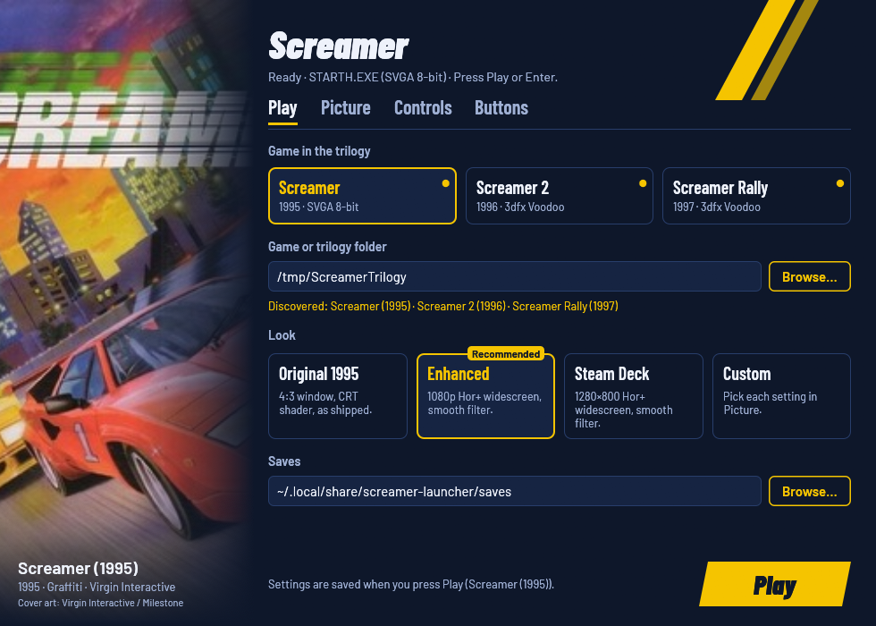
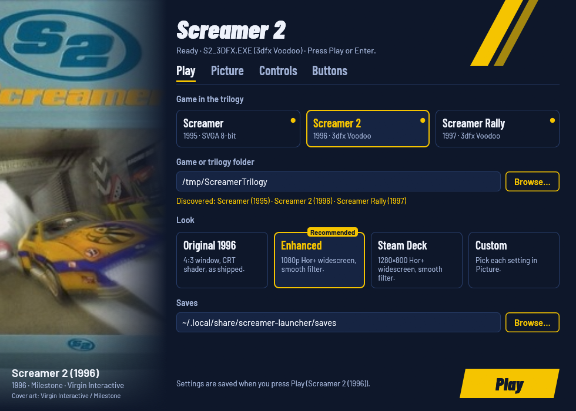
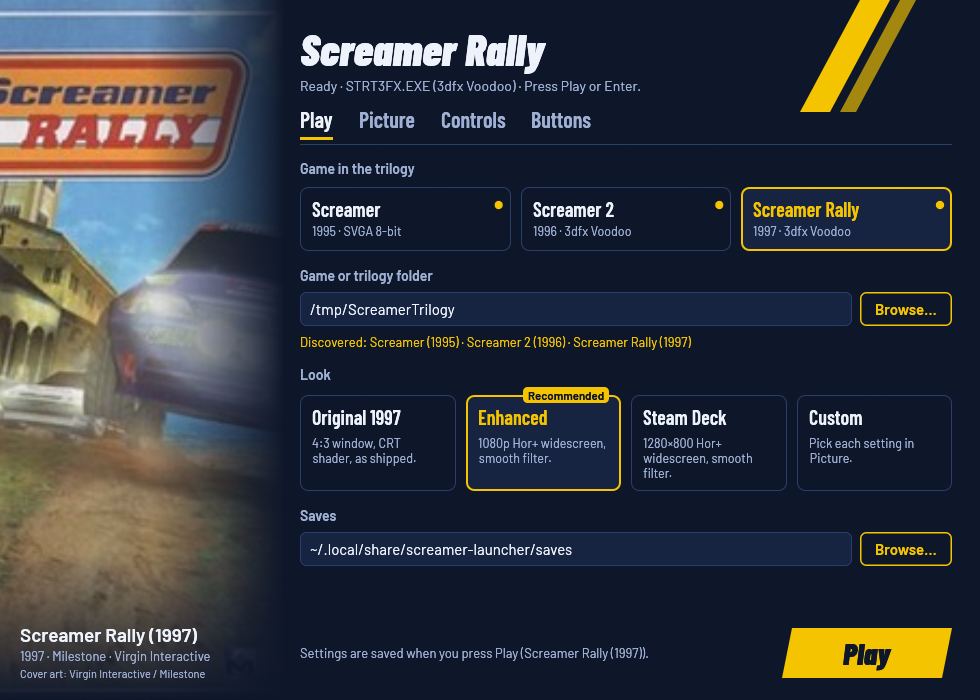
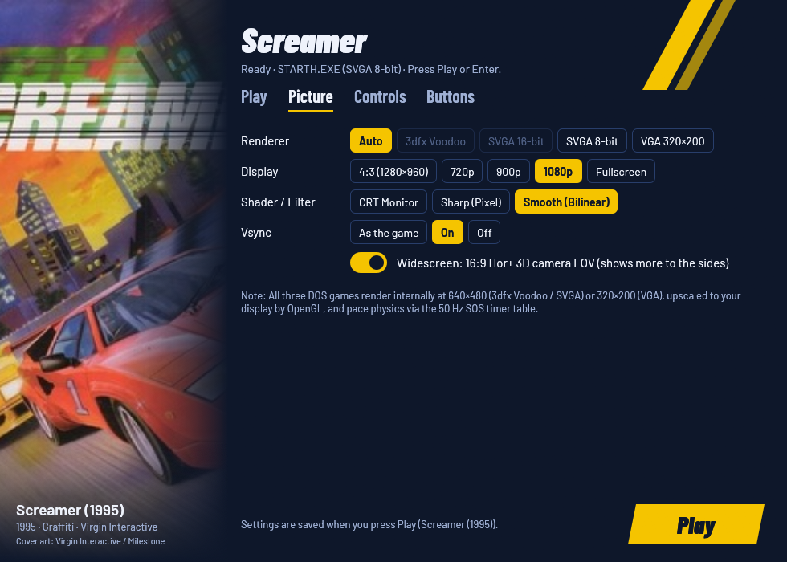
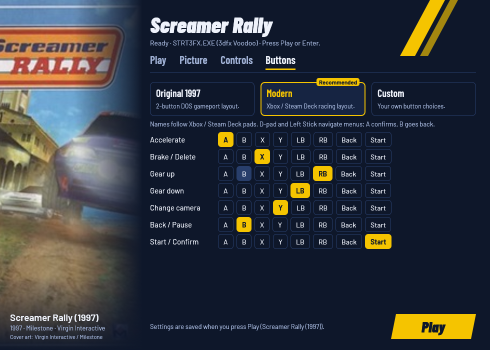

# Screamer Trilogy Launcher (`rea-screamer`)

A self-contained, cross-platform compatibility launcher and runtime enhancer for Milestone / Graffiti's classic MS-DOS arcade racing trilogy:

- **Screamer** (1995) — SVGA (`640×480` 8-bit) & VGA (`320×200`)
- **Screamer 2** (1996) — 3dfx Voodoo Glide (`640×480`) & SVGA (`640×480` 16-bit / 8-bit)
- **Screamer Rally** (1997) — 3dfx Voodoo Glide (`640×480`) & SVGA (`640×480` 16-bit / 8-bit)

Point `ScreamerLauncher` at a parent folder containing one, two, or all three games (from GOG or original CD-ROM releases) and press **Play**. Your original game files are treated as **strictly read-only** and are never modified.



---

## Screenshots

| Screamer 2 (1996) | Screamer Rally (1997) |
| :---: | :---: |
|  |  |

| Picture Tab (Per-Game Capability Filtering) | Buttons Tab (Live Controller Remapping) |
| :---: | :---: |
|  |  |

---

## Key Features

- **Unified Trilogy GUI & CLI (with Full Gamepad Navigation)**:
  - One executable (`ScreamerLauncher`) discovers **Screamer (1995)**, **Screamer 2 (1996)**, and **Screamer Rally (1997)** automatically from a single parent folder (or an individual game folder), complete with cover art and per-game capability filtering (unsupported renderers for the chosen game are automatically grayed out with an explanation on hover).
  - Navigate the entire launcher with a controller: focus starts on the **Game in the trilogy** row (`Left`/`Right` to pick a game, `Start` or `A` to launch **Play** immediately, `LB`/`RB` to switch between `Play`, `Picture`, and `Buttons` tabs, and `Up`/`Down`/`Left`/`Right` to adjust any option).
- **Zero Manual Setup**:
  - No `SETUP.EXE` / `ST.EXE` runs, no `Ctrl+F1` DOSBox mapper files, no CUE/ISO editing, and no manual `dosbox.conf` tweaking.
  - Synthesizes binary-exact `SCREAMER.CFG`, `CONFIG/SETUP.CFG` (Sound Blaster 16 `Port 0x220, IRQ 7, DMA 1` + OPL3), and `CONFIG/CONTROLS.CFG` before every launch, and stages existing `CONFIG/CHOICE.DAT` and `*.SAV` files into a private runtime folder (`~/.local/share/screamer-launcher/runtime/<game>/`).
- **Automatic GOG CUE & Redbook CD Audio Mounting**:
  - Detects GOG's CUE-sheet `.DAT` files (`SCREAM.DAT` -> `SCREAM.gog`, `GAME.DAT` -> `GAME.GOG`) as well as `.ISO`/`.CUE`/`.INS` images (`srally.iso`) and mounts them on `D:` with full 48 kHz Redbook CD-DA music tracks.
- **Automatic 3dfx Voodoo Glide Unlock & Texture-Cache Crash Fixes (`F7`, `F8`)**:
  - GOG's release of **Screamer 2** includes `S2_3DFX.EXE` alongside a `31 KB` Windows 9x port-`0x600` stub `glide2x.ovl` that fails in pure DOS. When `Screamer Rally` is present in the same trilogy folder, `ScreamerLauncher` automatically links the genuine `348 KB` DOS 3dfx driver (`GLIDE2X.OVL`) into Screamer 2's runtime directory so both **Screamer 2** and **Screamer Rally** run with hardware-accelerated 3dfx Voodoo Glide (`S2_3DFX.EXE` / `STRT3FX.EXE`).
  - Fixes the **Screamer Rally / Screamer 2 3dfx mid-level crashes**: `F7` wraps the 1,024-entry TMU residency ring, while `F8` maps excess textures to a live fallback if the separate 3,064-entry software descriptor pool is exhausted.
- **2× Internal 3dfx Voodoo Superscaling (`1280×960`), AMD FSR 1.0 (`EASU + RCAS`), & 100 FPS Optical-Flow Frame Generation**:
  - When an enhanced display resolution is selected (`1280×960`, `720p`, `900p`, `1080p`, or `Fullscreen`), our patched `vendor/dosbox-staging` 3dfx Voodoo emulator (`SCREAMER_VOODOO_SCALE=2`) scales internal Voodoo triangle setup (`ax..cy`), parameter gradients (`d*dx`, `d*dy`), clip windows, and 2D LFB HUD overlays to **`1280×960` (2× internal resolution)** while keeping `TMU0` at 2 MB for full texture-cache compatibility.
  - **AMD FSR 1.0 (`interpolation/fsr.glsl`)**: Edge-Adaptive Spatial Upsampling (**EASU**, 12-tap directional elliptical Lanczos2 with anti-ringing clamp) + Robust Contrast-Adaptive Sharpening (**RCAS**) upscales `1280×960` (Voodoo) or `640×480` (SVGA) cleanly to `1080p` / `1440p` / `4K` on any GPU (NVIDIA, AMD, Intel, Steam Deck).
  - **100 FPS GPU Optical-Flow Frame Generation (`SCREAMER_FRAME_GEN=1`)**: Because all three DOS games lock their internal SOS timer and 50-entry physics lookup table to `50 Hz` (`20 ms`), enabling `100 FPS (Frame Gen)` in the **Picture** tab synthesizes a motion-compensated optical-flow midpoint frame ($F_{t-0.5}$) every `10 ms` between $F_{t-1}$ and $F_t$ on the GPU (with static HUD/menu ghosting protection), doubling presentation smoothness from **50 FPS to 100 FPS** without altering game physics or timing.
  - Patches the 3×3 camera rotation matrix inside `SetCamera3D` (`E2`) to scale horizontal basis components (`M00, M01, M02`) by `3/4` (`0.75`). When presented in a 16:9 window or fullscreen display, the center 4:3 region retains exact original proportions while expanding horizontal field of view from 90° to ~106.3° without stretching cars or causing frustum pop-in at screen edges.
- **Modern Gamepad Support (`RT`/`LT` Analog Triggers + Direct Guest RAM Injection)**:
  - Works out of the box with both SDL `GameController` pads and newer Linux `evdev` / XInput controllers not yet in SDL2's built-in GUID database (such as the **8BitDo Ultimate 2 Wireless Controller**).
  - Cleanly maps **`RT` (`R2`)** to proportional `0..1023` Accelerator and **`LT` (`L2`)** to proportional `0..1023` Brake across all three games (with `LT` and `RT` selectable directly in the **Buttons** tab alongside `A`/`X`), plus full `-1023..+1023` analog steering, zero-deadzone option (`E5`), rumble feedback, and simultaneous keyboard + gamepad support in both menus and races.

---

## Installation & Usage

### Prebuilt Releases (Linux AppImage, Linux Zip & Windows Zip)

Every push and `v*` tag on GitHub Actions ([`.github/workflows/build.yml`](.github/workflows/build.yml)) builds three self-contained distribution packages:

- **Linux AppImage (`ScreamerLauncher-x86_64.AppImage`)**: Single-file portable bundle containing `ScreamerLauncher`, our statically hooked `dosbox`, `resources/`, `screamer-play`, and SDL2/codec libraries:
  ```bash
  chmod +x ScreamerLauncher-x86_64.AppImage
  ./ScreamerLauncher-x86_64.AppImage --game /path/to/screamer/games
  ```
- **Windows (`ScreamerLauncher-windows-x86_64.zip`)**: Unpack anywhere and run `ScreamerLauncher.exe` (includes the statically hooked `dosbox.exe`, `resources/`, and runtime DLLs in the same folder).
- **Linux Portable Archive (`ScreamerLauncher-linux-x86_64.zip`)**: Unpack and run `./ScreamerLauncher` or `./linux/screamer-play`.

### Prerequisites (When Building from Source)

1. Your own copy of **Screamer**, **Screamer 2**, and/or **Screamer Rally** (GOG or original CD releases).
2. Standard `dosbox-staging` build dependencies (`meson`, `ninja`, `pkg-config`, `sdl2`, `opusfile`, `speexdsp`, `fluidsynth`, `alsa`, `libpng`, `libslirp`, `glew`, `zlib`) when building from source.

### Building from Source

`dosbox-staging` (`v0.82.2`) is included as a git submodule at [`vendor/dosbox-staging`](vendor/dosbox-staging) and linked directly against our static `libscreamer_hooks.a` library (`screamer_hooks_on_tick` invoked deterministically on the main thread at the end of `GFX_Events()`, with no `LD_PRELOAD` or runtime `dlsym` hacks):

```bash
git submodule update --init --depth 1 vendor/dosbox-staging
./scripts/build-dosbox.sh
cargo test --workspace
cargo build --release --workspace
```

This produces two clean self-contained binaries in `target/release/`:
- `target/release/ScreamerLauncher` — the unified GUI/CLI launcher
- `target/release/dosbox` (plus `target/release/resources/`) — `dosbox-staging v0.82.2` with `libscreamer_hooks.a` statically compiled in, automatically used by `ScreamerLauncher`

### Running the Launcher

Point `--game` at your parent trilogy folder (or any single game folder) once; `ScreamerLauncher` saves the path in `~/.config/screamer-launcher/launcher.cfg`:

```bash
# Open the unified graphical launcher (remembers --game for future runs)
./target/release/ScreamerLauncher --game /path/to/screamer/games

# Or launch a specific game directly without opening the settings window
./target/release/ScreamerLauncher 1 --no-window       # Screamer (1995)
./target/release/ScreamerLauncher 2 --no-window       # Screamer 2 (1996)
./target/release/ScreamerLauncher rally --no-window   # Screamer Rally (1997)

# Verify discovered games, CD images, 3dfx Glide OVL status, and binary patches
./target/release/ScreamerLauncher --check --game /path/to/screamer/games
```

---

## Engine Limitations & Why Options Are Scaled to Match the DOS Engine

Unlike late-1990s Windows Direct3D games (where patching `IDirect3DDevice` allows rendering 3D geometry at native 4K), all three **Screamer** games are 32-bit DOS/4GW Watcom `LE` executables with fixed internal rasterizer dimensions and fixed-step physics tables:

### 1. Internal `640×480` Framebuffer vs. OpenGL Display Scaling
- **SVGA Software Modes (`STARTH.EXE`, `START65H.EXE`)** rasterize into a fixed `640×400` / `640×480` buffer and blit to VESA linear/banked memory (`0xA0000`).
- **3dfx Voodoo Glide Modes (`S2_3DFX.EXE`, `STRT3FX.EXE`)** initialize the Voodoo1 SST-1 at `GR_RESOLUTION_640x480` (`640×480` 16-bit) and convert integer screen coordinates via 640-entry `X_table` and 400-entry `Y_table` lookup arrays.
- Rather than offering a misleading "4K internal resolution" setting (which only causes `dosbox-staging` to log `Invalid 'viewport' setting` on smaller or portrait displays), the **Picture** tab provides clean **Display** targets (`4:3 (1280×960)` 2× integer window, `720p`, `900p`, `1080p`, and `Fullscreen`) paired with `dosbox-staging`'s OpenGL **Shader / Filter** pipeline:
  - **CRT Monitor (`crt-auto`)**: Authentic 1995 aperture-grille / scanline CRT presentation.
  - **Sharp (`sharp`)**: Crisp pixel-interpolated scaling with no blur.
  - **Smooth (`bilinear`)**: Bilinear OpenGL scaling + 3dfx Voodoo texture filtering.

### 2. The 100 Hz SOS Timer & 50-Entry Physics Lookup Table (`50 Hz` Ceiling)
- All three games register an HMI Sound Operating System (SOS) timer callback at **100 Hz (`10 ms` per tick)** and wait for **2 ticks (`20 ms` = `50.0 FPS`)** per frame (`UpdateFrameTiming`).
- After computing `smoothed_dt` (clamped to `[0.02s, 0.20s]`), the engine computes `idx = int(1.0 / smoothed_dt)` (`1..50`) and indexes a **50-entry precomputed physics lookup table** (`400` / `0x190` bytes per entry, storing per-framerate suspension, damping, friction, and gravity coefficients):
  - **Why `0.02s` cannot be lowered in Screamer 1**: `STARTH.EXE` (`0x01FCD4..0x01FD23`) has no upper bounds check on `int(1.0 / smoothed_dt)` before multiplying by `400` (`0x190`). Lowering the `0.02s` floor to `0.004s` produces indices up to `250`, reading past the end of the 50-entry table (`0x80e8..0xcf08`) and crashing when a level loads.
  - **Why `2` ticks cannot be lowered to `1` tick in Screamer 1**: Waiting only `1` tick (`10 ms`) while clamping `smoothed_dt >= 0.02s` advances car physics by `20 ms` every `10 ms`, making the game run at **1.4×–2.0× speed**.
  - **Why `0.02s` cannot be lowered in Screamer 2 / Screamer Rally**: Milestone added a `>= 50.0` clamp on the physics table index in Screamer 2 (`0x050DEC`), locking the table coefficients to `entry 50` (`dt = 0.02s`). If `smoothed_dt` is lowered below `0.02s`, `smoothed_dt` diverges from the `0.02s` suspension table on frame 1, causing **all cars on the starting grid to jump into the air and crash into one another**.
- Keeping the native `2`-tick (`0.02s` / `50 Hz`) step unpatched guarantees 1.0× game speed and rock-solid suspension physics across all three games.

---

## Gamepad & Button Mapping Shenanigans

Getting a modern wireless controller to work seamlessly across menus, driver name entry, and racing in 1995–1997 DOS games required solving five distinct engine quirks inside [`crates/screamer-hooks`](crates/screamer-hooks/src/lib.rs):

1. **Why DOS Gameport `0x201` Fails at `cpu_cycles_protected = max`**:
   - The original DOS binaries poll port `0x201` in a tight loop (`DetectJoystick`, max `0x800` iterations) waiting for the simulated RC capacitor to discharge. Under `cpu_cycles_protected = max`, a modern CPU finishes `0x800` iterations before the virtual capacitor discharges, so the game concludes no joystick is connected.
2. **Source-Level Hook in `dosbox-staging` (`GFX_Events()`) & Direct Guest RAM (`MemBase`) Injection**:
   - Rather than relying on fragile `LD_PRELOAD` / `dlsym` / `clock_gettime` interception across audio and renderer threads, [`vendor/dosbox-staging`](vendor/dosbox-staging) (`src/gui/sdlmain.cpp`, patch in [`patches/dosbox-staging-screamer-hooks.patch`](patches/dosbox-staging-screamer-hooks.patch)) statically links `libscreamer_hooks.a` and calls `screamer_hooks_on_tick(&api, now_ns)` on the main thread right at the end of `GFX_Events()`, passing `MemBase`, `MEM_TotalPages() * 4096`, `KEYBOARD_AddKey`, `JOYSTICK_*`, and `SDL_*` callbacks directly.
   - `PollControls` in all 8 racing executables checks `if (record[r].enabled == 1)` before overwriting `normalized_controls[r]`, while the car physics engine reads `normalized_controls[0..5]` (`-1023..+1023`) directly without checking `record[r].enabled` (and uses full-range proportional steering when `record[2].mode == 0`).
   - `screamer_hooks_on_tick` locates the loaded Data Object in `MemBase` (on 4096-byte page boundaries), sets `record[r].enabled = 2`, `record[r].ctrl_type = 1`, `record[r].mode = 0`, and writes live 10-bit proportional steering (`norm[2]`), throttle (`norm[0]`), brake (`norm[1]`), and gear shifts (`norm[4..5]`) directly into guest RAM.
3. **Why `MenuPollInput` Also Calls `PollControls` in Menus**:
   - In all three games, the menu loop (`MenuPollInput`) also calls `PollControls` every frame. If `record[r].ctrl_type == 2` and `record[r].mode != 0`, `MenuPollInput` interprets `normalized_controls[0..3]` as menu directional presses. Setting `ctrl_type = 1`, `mode = 0`, and `norm[3] = 0` prevents analog race state from poisoning menu navigation, while edge-triggered synthetic keystrokes (`KEYBOARD_AddKey`) drive menus and Driver Name Input cleanly.
4. **The Watcom `LE` Keyboard BSS vs. ASCII String Trap (`data_obj[2 + 72] == 'f'`)**:
   - To allow simultaneous keyboard and gamepad play, `screamer-hooks` checks whether a bound keyboard scancode is pressed before overriding a control record.
   - However, in the Watcom `LE` binary layout, the 130-byte (`0x82`) keyboard state array lives in a separate preceding BSS object, whereas `data_obj[0..130]` contains initialized ASCII strings — and `data_obj[2 + 72]` (the offset for Up Arrow scancode `72`) happens to contain the ASCII byte `'f'` (`102 != 0`)!
   - Verifying that `data_obj[2..90]` contains only boolean `0`/`1` bytes (`has_clean_kbd_array`) and prioritizing active gamepad input (`gp.throttle > 0`) prevents mistaking the `'f'` byte for a held Up Arrow key.
5. **Deterministic Main-Thread Execution**:
   - Because `screamer_hooks_on_tick` runs on the main thread at the end of `GFX_Events()` right after `while (SDL_PollEvent(&event))` has pumped all SDL events, SDL controller and joystick state is always up-to-date and single-threaded without any background thread locks or symbol-lookup overhead.

### Default Modern Controller Layout

| Controller Input | In Menus & Driver Name Input | In Race |
| :--- | :--- | :--- |
| **D-Pad / Left Stick** | Navigate Up / Down / Left / Right | Proportional analog steering (`-1023..+1023`) |
| **R2 Trigger / Right Stick Up** | — | Proportional analog throttle (`0..1023`) |
| **L2 Trigger / Right Stick Down** | — | Proportional analog brake (`0..1023`) |
| **A (South)** | Confirm selection / Enter character (`Enter`) | Full throttle (`1023`) |
| **B (East)** | Back / Cancel (`Esc`) | Pause race (`Esc`) |
| **X (West)** | Delete character on Name Input (`Backspace`) | Full brake / reverse (`1023`) |
| **Y (North)** | — | Change camera view (`M` in Screamer 1, `C` in Screamer 2/Rally) |
| **RB (Right Bumper)** | — | Shift gear up |
| **LB (Left Bumper)** | — | Shift gear down |
| **Start** | Skip intro / Confirm driver name (`Enter`) | Confirm pause menu item (`Enter`) |
| **Back / Select** | Back (`Esc`) | Pause race (`Esc`) |

All button assignments can be customized in the **Buttons** tab (`Modern`, `Original`, or `Custom`) or via `buttons = ...` in `launcher.cfg`.

---

## Documentation

Detailed reverse-engineering notes, Watcom `LE` relocation tables, binary SHA-256 digests, and runtime verification logs are in [`docs/`](docs/):

- [`docs/01-distrobox-gaming-findings.md`](docs/01-distrobox-gaming-findings.md) — Game directory layouts, CUE/GOG CD images, and DOSBox environment analysis
- [`docs/02-cmr-launcher-architecture.md`](docs/02-cmr-launcher-architecture.md) — Launcher UI and configuration architecture
- [`docs/03-screamer-binary-analysis.md`](docs/03-screamer-binary-analysis.md) — Watcom `LE` object tables, `SETUP.CFG` / `CONTROLS.CFG` binary formats, and executable hashes
- [`docs/04-screamer-engine-and-patches.md`](docs/04-screamer-engine-and-patches.md) — 3D projection matrices, Hor+ widescreen math, SOS timer & 50-entry physics lookup table, and `PollControls` internals
- [`docs/RUNTIME_NOTES.md`](docs/RUNTIME_NOTES.md) — Runtime verification findings, `MemBase` injection rules, `MenuPollInput` behavior, and `clock_gettime` thread-safety notes

---

## License

MIT — see [`THIRD_PARTY.md`](THIRD_PARTY.md) for open-source component attributions (`dosbox-staging`, `eframe`/`egui`, Barlow fonts). No copyrighted game executables or assets are included in this repository.
